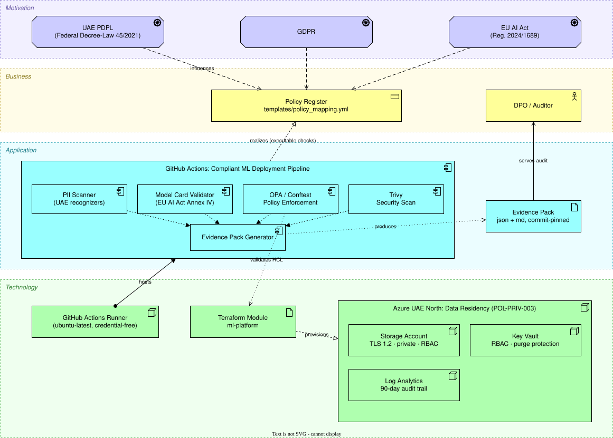

# GitOps for Compliant AI

[](https://github.com/MohamedMubarak123/gitops-compliant-ai/actions/workflows/ci.yml)
[](LICENSE)
[](https://www.python.org/downloads/)

**Drop-in compliance gates for ML pipelines** — reusable GitHub Actions that
make UAE PDPL, GDPR, and EU AI Act requirements *machine-enforced* in CI,
not paragraphs in a policy document nobody checks.

```yaml
# .github/workflows/compliance.yml — full adoption in one job
jobs:
  compliance:
    uses: MohamedMubarak123/gitops-compliant-ai/.github/workflows/compliance-gates.yml@v1
    with:
      data-path: ./data
      model-cards-path: ./model_cards
      terraform-paths: "infra/*.tf"
```

## Why this exists

Teams shipping ML in the Gulf face three regulatory pressures at once: the
**UAE Personal Data Protection Law** (Federal Decree-Law 45/2021), **GDPR**
for any EU data subjects, and the **EU AI Act** for AI systems touching the
EU market. The usual answer is a compliance spreadsheet that drifts from
reality the day it's written.

This toolkit takes the GitOps answer instead: **every policy is an executable
check that blocks the pipeline.** If your Terraform allows public network
access, the build fails and cites the PDPL article you'd be violating. If a
dataset contains an Emirates ID, it never reaches training.

## The gates

| Action | What it enforces | Regulation |
|--------|------------------|------------|
| `pii-scan` | Datasets are free of PII — including **UAE-specific patterns** (Emirates ID, +971 phones, AE IBANs) that generic scanners miss | UAE PDPL Art. 20, GDPR Art. 32 |
| `model-card-check` | AI documentation is complete; every missing field cites the **EU AI Act article** it fails | EU AI Act Annex IV, Art. 9/13/14 |
| `policy-check` | Terraform satisfies the policy register via **OPA/Conftest** — TLS 1.2, no public access, UAE-only regions, RBAC, audit logging, retention | UAE PDPL Art. 9, 20, 22-23; GDPR Art. 5, 30, 32 |
| `evidence-pack` | Every run emits an **auditor-facing artifact**: what was checked, against which regulation, at which commit | GDPR Art. 5(2), EU AI Act Art. 12 |

Each gate is also a standalone composite action:

```yaml
steps:
  - uses: actions/checkout@v4
  - uses: MohamedMubarak123/gitops-compliant-ai/.github/actions/pii-scan@v1
    with:
      path: ./data
  - uses: MohamedMubarak123/gitops-compliant-ai/.github/actions/policy-check@v1
    with:
      terraform-paths: "infra/*.tf"
```

## Make the policies yours

Nothing is hardcoded to this repo's profile. Copy
[`templates/compliance.config.yml`](templates/compliance.config.yml) into
your repo to:

- add your own PII patterns (a KSA Iqama example is included) or disable
  built-in ones
- swap the model card schema for your internal documentation policy or
  another framework (NIST AI RMF, ISO 42001)

and point the `config` input at it. The infrastructure rules live in
[`policy/`](policy/) as plain Rego — fork the policy pack, keep the engine.
The policy register
([`templates/policy_mapping.yml`](templates/policy_mapping.yml)) maps every
policy to the regulation it implements *and* the executable check that
enforces it — nothing in it is decorative.

## How the gates fail

A compliance gate is only worth the trust you put in it if it fails in the
right direction. Every gate here follows one contract:

| Exit code | Meaning | CI result |
|-----------|---------|-----------|
| `0` | Checked something, found nothing wrong | ✅ pass |
| `1` | Policy violation — PII found, card incomplete, Terraform non-compliant | ❌ blocked |
| `2` | **Misconfigured** — the gate could not check what it was pointed at | ❌ blocked |

Exit code `2` is the one that matters. A gate pointed at a path that matches
no files does **not** report success: a mistyped `data-path` would otherwise
produce a green check, and an evidence pack asserting compliance for a scan
that examined nothing. If scanning nothing is genuinely expected, opt in
explicitly:

```yaml
- uses: MohamedMubarak123/gitops-compliant-ai/.github/actions/pii-scan@v1
  with:
    path: ./data
    allow-empty: true   # only if an empty data directory is normal for you
```

The same principle runs through the rest of the toolkit:

- An unreadable or malformed input file is treated as a **finding**, not as
  a pass.
- A gate that never ran appears in the evidence pack as `NOT_RUN`, so a
  crashed check can't quietly disappear from the audit artifact.
- A malformed `compliance.config.yml` stops the run with a message naming
  the offending key, rather than being silently ignored.

## Architecture



Modeled in **ArchiMate 3** notation: regulatory drivers (motivation layer)
shape the policy register (business layer), which is *realized* — not just
referenced — by the executable CI gates (application layer) running against
the Terraform-provisioned Azure UAE North platform (technology layer).

Editable source: [`docs/architecture.drawio`](docs/architecture.drawio) —
open with [draw.io / diagrams.net](https://app.diagrams.net).

## Try it locally

Requires **Python 3.9+**.

```bash
git clone https://github.com/MohamedMubarak123/gitops-compliant-ai.git
cd gitops-compliant-ai
pip install -r requirements.txt

# Watch the PII gate block dirty data (Emirates IDs, UAE phones, IBANs)...
python scripts/pii_scanner.py --path ./examples/sample_data/customers.csv

# ...and pass anonymized data
python scripts/pii_scanner.py --path ./examples/sample_data/customers_anonymized.csv

# Validate model cards against EU AI Act Annex IV
python scripts/model_card_validator.py --path ./examples/model_cards/compliant
python scripts/model_card_validator.py --path ./examples/model_cards/non_compliant  # see it fail
```

All sample data is **synthetic**. The examples double as this repo's
integration tests — CI runs every gate against them, including negative
tests proving the gates actually block.

For NLP-based detection of names and locations (Microsoft Presidio), add
`pip install -r requirements-nlp.txt`; the scanner upgrades automatically.

## UAE-specific PII detection

Generic PII scanners don't know what an Emirates ID looks like. This one does:

| Entity | Pattern | Example (synthetic) |
|--------|---------|---------------------|
| `AE_EMIRATES_ID` | `784-YYYY-NNNNNNN-C` | 784-1985-1234567-1 |
| `AE_PHONE_NUMBER` | +971 / 05X mobile & landline | +971-50-123-4567 |
| `AE_IBAN` | `AE` + 21 digits | AE07 033 1234... |

## Reference infrastructure (Azure UAE North)

`infrastructure/` contains a complete Terraform module for a compliant ML
platform — storage with TLS 1.2/private access/RBAC, Key Vault, Log
Analytics audit trail, compliance tags — that passes the full policy pack.
Use it as a starting point or bring your own Terraform; the `policy-check`
gate works against any HCL.

## Repository layout

```
├── .github/
│   ├── actions/           # Reusable composite actions (the product)
│   └── workflows/         # ci.yml (dogfooding) + compliance-gates.yml (workflow_call)
├── scripts/               # Gate engines: PII scan, model cards, evidence pack
├── policy/                # OPA/Rego policy pack (UAE PDPL / GDPR profile)
├── templates/             # Policy register + compliance.config.yml
├── infrastructure/        # Reference Terraform (Azure UAE North)
├── examples/              # Synthetic fixtures — doubles as integration tests
│   ├── sample_data/       #   clean + deliberately dirty CSVs
│   ├── model_cards/       #   compliant + non-compliant cards
│   └── terraform/         #   deliberately non-compliant HCL
├── tests/                 # pytest suite
└── docs/                  # ArchiMate architecture (drawio + svg)
```

## Roadmap

- [x] `v1` release tag
- [ ] GitHub Marketplace listing for the individual actions
- [ ] Arabic-language PII detection (Arabic names, addresses)
- [ ] KSA PDPL and Qatar PDPPL policy packs
- [ ] pip-installable CLI for GitLab / Azure DevOps / pre-commit
- [ ] `terraform plan` JSON enforcement for deployed-state drift
- [ ] Signed evidence packs (Sigstore/cosign attestation)

## Contributing

Policy packs for new jurisdictions and region-specific PII recognizers are
especially welcome — see [CONTRIBUTING.md](CONTRIBUTING.md).

Release notes live in [CHANGELOG.md](CHANGELOG.md). Security issues —
**including any gate that passes when it should block** — go through the
private channel in [SECURITY.md](SECURITY.md), not a public issue.

## License

MIT — see [LICENSE](LICENSE).
